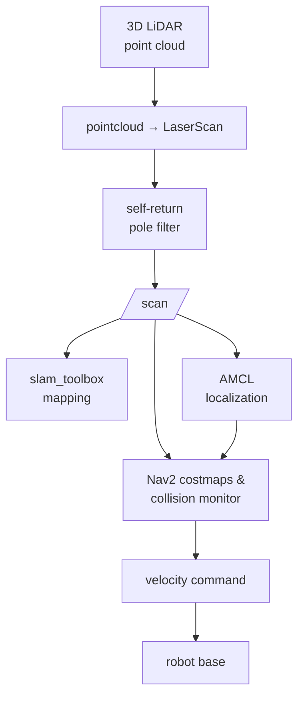
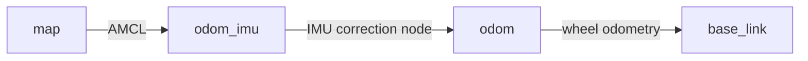
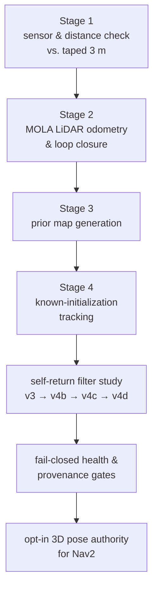

<!--
  PUBLISHING NOTES (HTML comment — not rendered on GitHub)
  - Anonymized on purpose: no company, robot, client or teammate names. Add them only with written permission.
  - Contains no company source code, configs, logs or photos. Diagrams below are redrawn from scratch.
  - Before publishing, double-check every number against Internship_Summary.md and the handoff docs.
-->

# Indoor Mobile Robot Autonomy — Robotics Internship (Summer 2026)

> **Note:** The source code is proprietary to the company, so this repository is a write-up only. It describes my role, the system design and the results. All diagrams are redrawn by me, and no company code or data is included.

- **Role:** Robotics Software Engineering Intern (one of two interns) · **Duration:** Jun 30 – Aug 27, 2026 (2 months)
- **Context:** R&D platform for a company building commercial airport service robots. The 3D work targeted their next-generation robot.
- **Platform:** Differential-drive indoor robot (AgileX Scout Mini base, 3D LiDAR, 9-axis IMU, RGB-D camera)
- **Stack:** ROS 2 Jazzy · Nav2 · slam_toolbox · AMCL · MOLA · AprilTag · Python · C++

---

## TL;DR

| Workstream | What I did | Outcome |
|---|---|---|
| **2D SLAM & navigation** | Built mapping, localization and navigation from the initial ROS 2 package up | ✅ Validated on the moving robot; integrated into the production stack |
| **IMU integration** | Replaced unstable wheel-yaw / EKF fusion with an IMU-prioritized correction frame | ✅ Production-integrated |
| **Nav2 tuning** | Repeated physical trials: DWB vs. MPPI, several planners, costmaps, recovery, stopping | ✅ Core navigation in production use |
| **AprilTag parking** | Tag pose → heading alignment → approach | ✅ Basic align-and-approach shown on the robot · precision docking planned, then deferred |
| **3D LiDAR SLAM & localization** *(led)* | MOLA mapping, prior maps, self-return filter study, fail-closed health gates | 🧪 Short supervised Nav2 goal driven by 3D localization; still a development candidate |
| **Object detection** *(side assignment)* | Benchmarked 3 detectors on a 39-class, 11.6k-image dataset and built a demo app | 📊 Best mAP@50 **86.75%** (RF-DETR-Nano) |

I demonstrated almost all of these workstreams to the CEO as they progressed, including the final 3D-localized navigation run.

---

## 1. 2D SLAM, Localization & Navigation — built from scratch

- Created the robot's ROS 2 autonomy package and its launch/config structure.
- Converted 3D LiDAR data into a 2D LaserScan and filtered out returns from the robot's own mounting poles.
- Connected `slam_toolbox` mapping, AMCL localization and Nav2 navigation into one workflow, with map saving and selection.

### The hard part: IMU integration
Heading from wheel odometry drifted, and fusing wheel and IMU yaw with an EKF was not stable. Instead of patching the fusion further, I kept the failed approach separate from the working baseline and redesigned the TF tree so that a dedicated node lets the IMU own yaw correction:

Each transform has exactly one owner. This turned out to matter a lot: code that assumed the default `map → odom` edge could look correct while reading or publishing the wrong transform.

**Final closeout run (Aug 26):** 1.099 m straight drive, 93.5° in-place rotation, 20/20 zero-velocity commands after cancel, single-owner TF and AMCL convergence, all checked on the moving robot.

## 2. Nav2 Tuning on the Real Robot

- Hit the limits of the DWB controller and introduced MPPI as a selectable alternative.
- Compared several global planners (A*, Navfn/GridBased and Lattice/Hybrid families).
- Tuned footprint, inflation and costmaps for narrow corridors and doorways.
- Worked through in-place rotation, corner and S-curve tracking, spin/back-up recovery, and cancel/stop behavior.
- Reverted changes that made behavior worse instead of keeping them.

**Main lesson:** "navigation doesn't work" can come from very different places. The planner may fail to find a path, the controller may fail to follow it, the costmap may mark a passage as blocked, recovery may be rejected for lack of space, or manual-drive timeouts may delay a stop. Separating these causes mattered more than finding one good parameter.

## 3. AprilTag-Assisted Parking

The loop: detect the tag → estimate distance and heading from tag size and camera calibration → spin or drive a short step → **re-detect before trusting the next estimate**.

The robot reached its target with this basic align-and-approach behavior. Bugs I found and fixed along the way:
- The tag size in the config was wrong (6.8 cm vs. an actual 4.8 cm), which scaled every distance by about 1.42×.
- The camera yaw offset was missing.
- The 0.41 m offset from the robot center to its front edge was missing, so the target landed *under* the robot.
- At longer range, the IPPE pose solver sometimes returned a flipped orientation.

Precision docking (about ±1–2 cm) was designed, then deferred. It was not implemented.

## 4. 3D LiDAR SLAM & Localization (MOLA) — workstream I led

- **Sensor check:** the two cleanest taped 3 m runs measured 2.996 m and 3.007 m. A vertical bias of about 8–9 cm remained.
- **Self-return filtering:** the robot's own structure created "mast trails" and X-shaped phantom points in the map. I compared four filter candidates on the *same frozen frame population*. I rejected v3 (artifacts remained), v4b (too limited) and v4c (it hurt odometry), and adopted a ±36° angular mask (v4d) with a full provenance chain.
- **Fail-closed health monitor:** it starts in INIT, never treats NaN as "fine", and requires every metric channel before trusting a correction. When I fed in a seed that was wrong by about 2.9 m and 21°, it stayed in INIT for 2,619 frames and accepted zero corrections.
- **Live stationary gate (Aug 25):** 9/9 localization quality criteria passed (residual p95 median 5.31 cm, stationary scatter p95 8.7 mm, match time 29.4 ms), and point-cloud delivery was 13,888/13,888. The system-level gate in the same session failed (9/11) because of a MOLA pose gap and one unaccounted record.
- **Nav2 integration (Aug 27):** I made 3D localization the single owner of the robot's pose for Nav2, guarded by a fail-closed check. A short supervised goal succeeded: the robot moved 0.299 m and stopped within tolerance. The first attempt aborted on a 37 ms stale transform. I kept it on record as a failure and fixed the test harness, which had wrongly reported it as complete.

**Honest scope:** this was one short trial starting from a pose a person had confirmed (known initialization). It is not global relocalization, there is no external ground truth, and AMCL remains the production default.

## 5. Side Assignment — Hospital Equipment Detection

- Prepared a 39-class, 11,621-image dataset with consistent train/val/test splits for both YOLO and COCO formats.
- Trained **YOLO26n, YOLO26l and RF-DETR-Nano** and evaluated all three on the same 1,170-image held-out set with a shared evaluator.
- Results: RF-DETR-Nano reached **mAP@50 86.75% / mAP@50:95 74.11% / recall 87.68%**, and YOLO26n ran at **29.8 FPS** on an Apple M1 (MPS).
- Built a FastAPI demo for upload and webcam input that compares all three models side by side.

---

## Debugging Stories

| Symptom | Root cause | Lesson |
|---|---|---|
| A fix in the source didn't change behavior | Stale ROS 2 `install/` artifacts | Treat "code in the repo" and "artifact that is running" as separate evidence |
| Offline results didn't carry over to live runs | The same policy was duplicated across scripts, YAML and launch defaults | Make configuration an executable, tested contract (2,639-record parity check) |
| Sensors and ports stayed busy after shutdown | Wrapper PID ≠ child PIDs | Check PID trees and ports, not process-name counts |
| A metric reported AUC 0.82, true value about 0.51 | Tied values got arbitrary ranks | Metric code needs analytic test cases too |
| Localizer said "HEALTHY" while the pose was wrong | Residual and fitness measure internal agreement, not truth | Never rename internal consistency as accuracy |

## What I Learned

Robot performance depends on the whole runtime system, not just the algorithm. Timestamps, TF ownership, stale builds, duplicate processes, QoS and data provenance can each invalidate a promising result. I also learned to separate tracking from relocalization, replay from physical validation, and "working code" from "production-ready", and to report what *didn't* work as clearly as what did.

## Next Steps I Proposed

Longer 3D-localized routes · true global relocalization · precision AprilTag docking · independent LiDAR–IMU extrinsic calibration · multi-modal localization (LiDAR + IMU + visual + fiducials).

---

Implementation and analysis were assisted by AI coding agents (Claude, Codex). I made the problem framing, robot operation, experiment design and accept/reject decisions. A fellow intern led the RGB-D visual SLAM work, which is not included here. The operations dashboard and parts of the late-stage Nav2 work were shared.
